# Architecture (v0.2)

> Diagrams are written in **Mermaid**. They render automatically on GitHub. In VS Code, install the extension **"Markdown Preview Mermaid Support"** (`bierner.markdown-mermaid`) and open the preview with `Cmd+Shift+V`.

**Contents**
1. [System context](#1-system-context)
2. [Volume and what it implies](#2-volume-and-what-it-implies)
3. [Phase 1: components](#3-phase-1-components)
4. [Phase 1: the LangGraph workflow](#4-phase-1-the-langgraph-workflow)
5. [One ticket, step by step (sequence)](#5-one-ticket-step-by-step)
6. [Routing decision](#6-routing-decision)
7. [Knowledge-base ingestion](#7-knowledge-base-ingestion)
8. [Data flow and PII boundary](#8-data-flow-and-pii-boundary)
9. [Evaluation and benchmark pipeline](#9-evaluation-and-benchmark-pipeline)
10. [Phase 2: scaled system](#10-phase-2-scaled-system)
11. [Phase 2: ticket lifecycle with the helpdesk](#11-phase-2-ticket-lifecycle-with-the-helpdesk)
12. [Phase 1 → Phase 2: what changes](#12-phase-1--phase-2-what-changes)
13. [Key design choices](#13-key-design-choices)
14. [Code layout](#14-code-layout)

---

## 1. System context

Who and what the co-pilot talks to. It **never talks to customers**: agents send every reply.

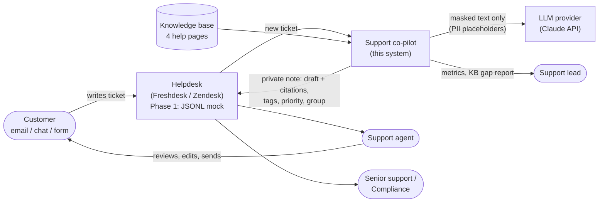

---

## 2. Volume and what it implies

| | Calculation | Result |
|---|---|---|
| Per month | given | 10,000 |
| Per day | 10,000 ÷ 30 | ≈ 330 |
| Per hour (average) | 330 ÷ 24 | ≈ 14 |
| Peak hour | ≈ 5× average (business hours) | ≈ 70 |
| Peak per minute | 70 ÷ 60 | ≈ 1–2 |

Throughput is not the problem; **reliability and safety are**. Phase 1 processes tickets directly; Phase 2 adds a simple queue for retries and spikes. No Kafka.

---

## 3. Phase 1: components

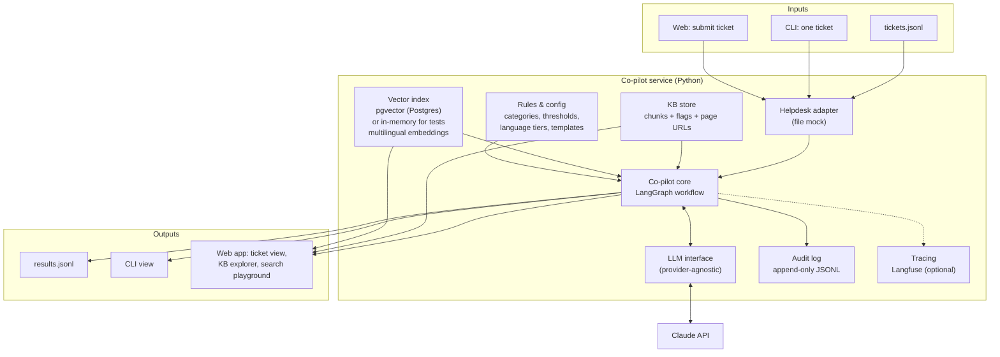

---

## 4. Phase 1: the LangGraph workflow

A **workflow (state machine)**, not autonomous multi-agents: two LLM nodes, deterministic nodes around them, conditional edges for routing (decision D3). Rectangles = code, hexagons = LLM calls.

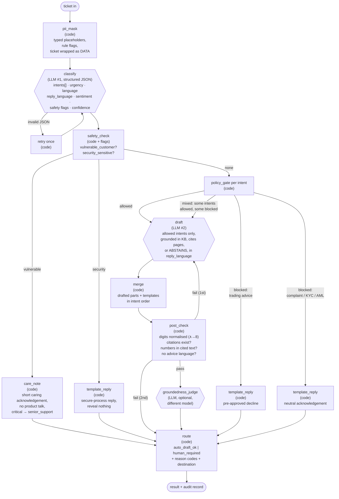

### Human-in-the-loop for account actions (LangGraph `interrupt`)

When a ticket needs the customer's account checked (`account_action_required`, e.g. "my approved withdrawal never arrived"), the workflow **pauses**, saves its state, waits for the agent, then **resumes** where it stopped.

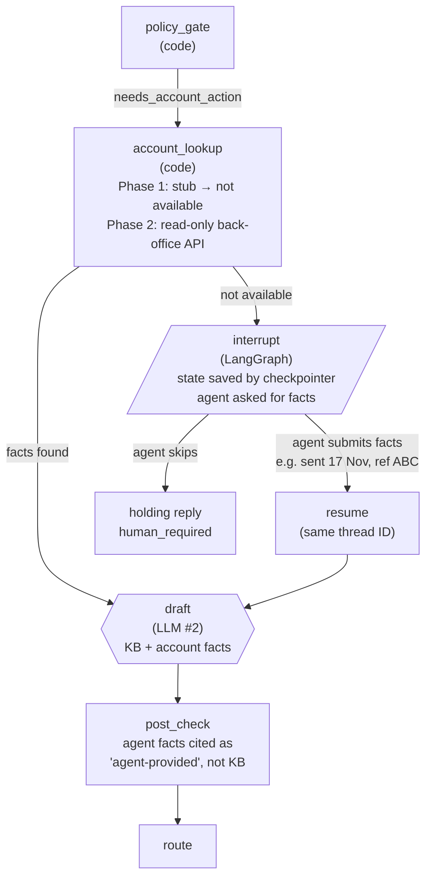

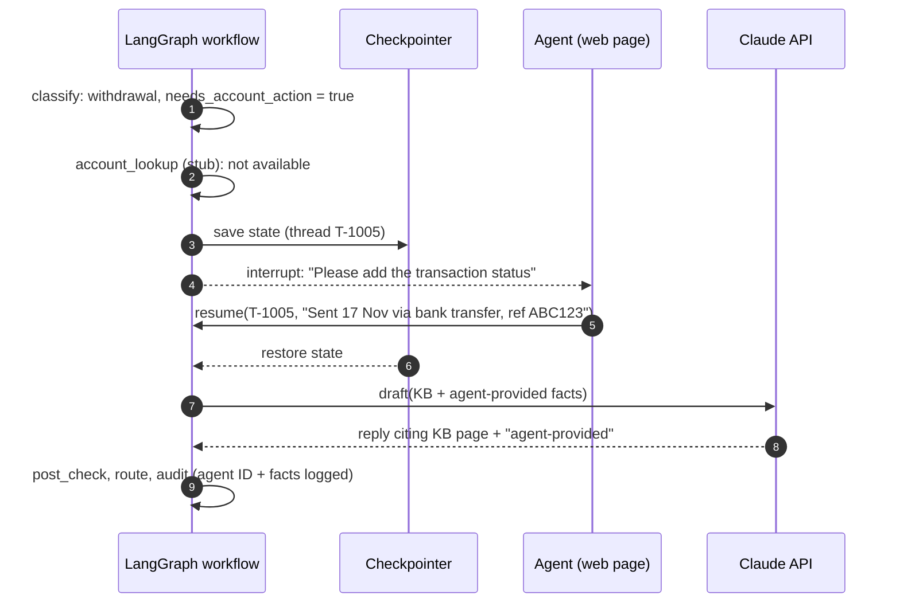

**Graph state** (one object passed between nodes):

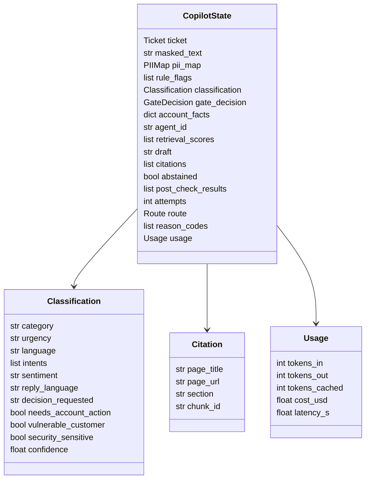

`pii_map` is never sent to the LLM or written to logs.

---

## 5. One ticket, step by step

Example: *"What is the minimum deposit, and what are your fees?"* (partly covered: minimum yes, fees no).

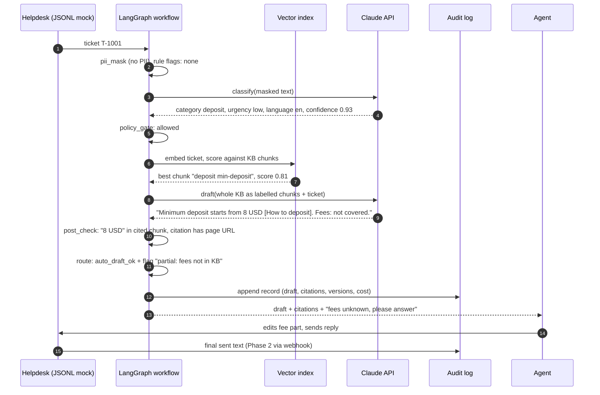

---

## 6. Routing decision

Any trigger fires → `human_required` with its reason code (PRD FR-5.1).

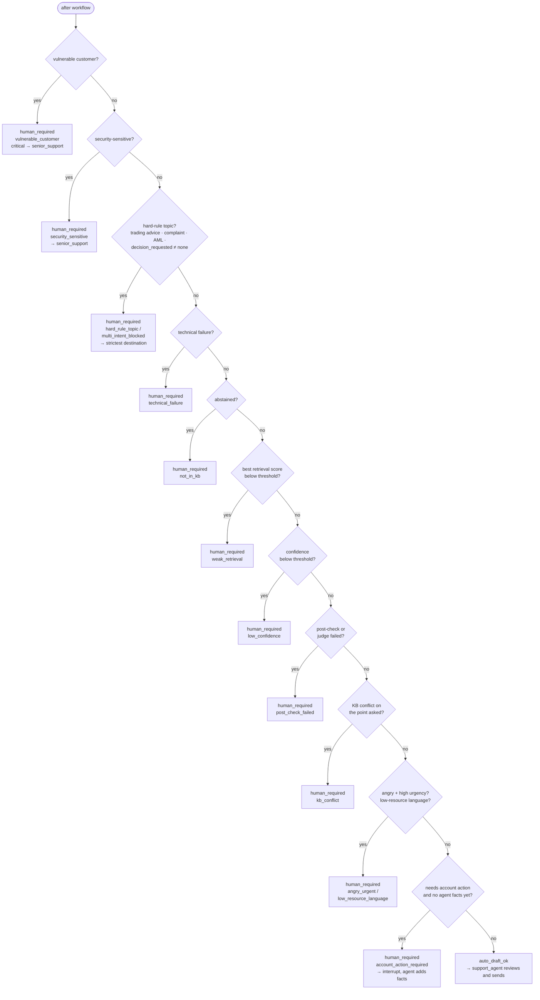

In code, all triggers are evaluated and **every** reason code that fires is recorded (not only the first), so metrics count each cause.

---

## 7. Knowledge-base ingestion

Pages are used **as they are** (never edited); problems are flagged, and how the co-pilot handles each one is a documented choice.

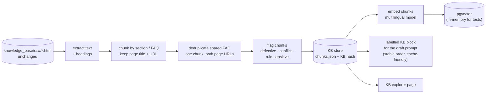

| Flag | Example | Handling |
|---|---|---|
| `defective` | withdraw steps copy-pasted from deposit ("amount to deposit", "Start Trading!") | kept, visible in explorer, never used for withdrawal answers |
| `duplicate` | 9-question FAQ on both deposit and withdraw pages | stored once, cites both page URLs |
| `conflict` | "instant" vs "within 60 minutes"; withdrawals "instant" vs "pending" queue | conservative statement + `kb_conflict` flag to agent |
| `rule_sensitive` | "What leverage should I select?" | may state documented max (1:2000), never suggest a setting |
| gap (no chunk) | fees, payment methods, withdrawal limits | abstain → `not_in_kb` |

---

## 8. Data flow and PII boundary

What leaves our service, and in what form.

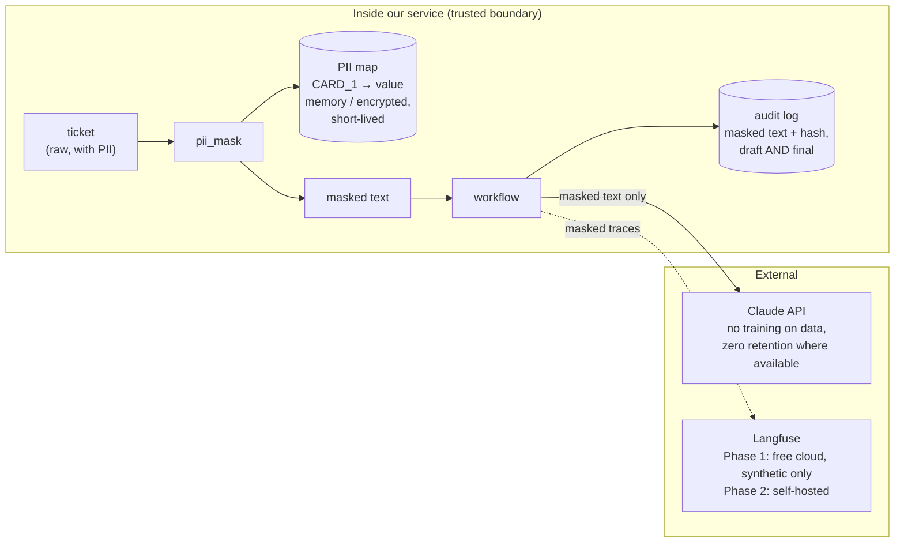

The PII map **never** crosses the boundary: it is not sent to the LLM, not traced, not logged in clear text.

---

## 9. Evaluation and benchmark pipeline

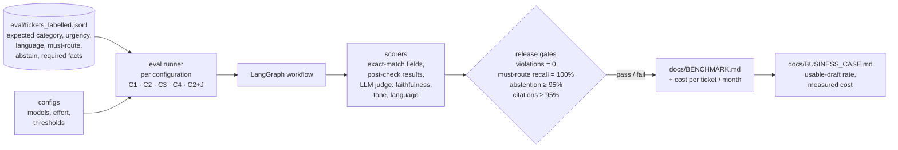

---

## 10. Phase 2: scaled system

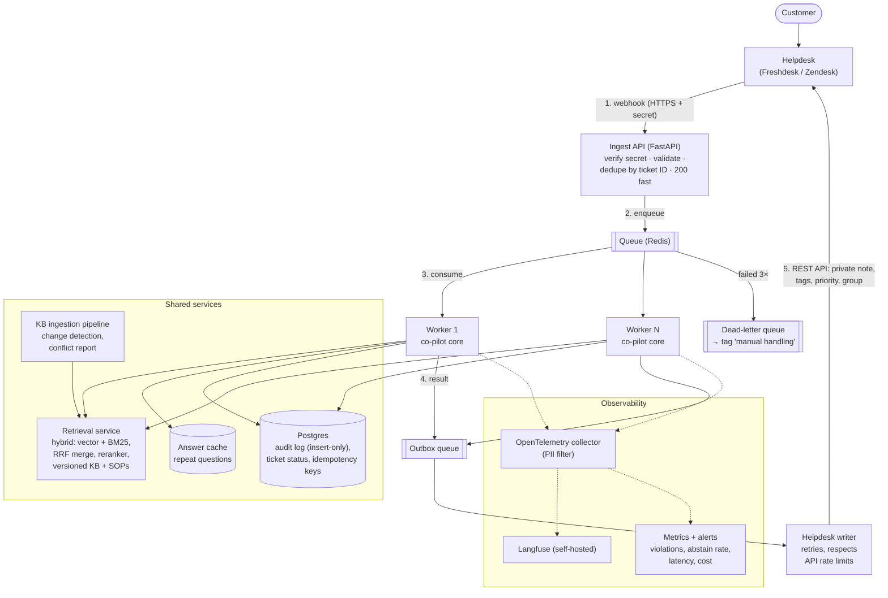

---

## 11. Phase 2: ticket lifecycle with the helpdesk

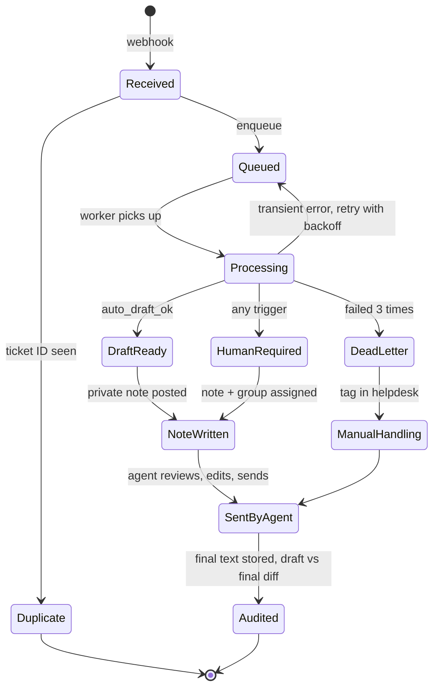

---

## 12. Phase 1 → Phase 2: what changes

| Concern | Phase 1 (`v1-ship`) | Phase 2 (`v2-scale`) |
|---|---|---|
| Ticket intake | JSONL file / CLI / web form | Helpdesk webhook → ingest API |
| Processing | direct, in-process | Redis queue + workers, retries, DLQ |
| Idempotency | not needed | ticket-ID keys in Postgres |
| Return path | results.jsonl / web page | outbox → helpdesk REST API (private note) |
| KB in prompt | whole KB (~2.5k tokens) | top-k from hybrid retrieval + reranker |
| KB updates | manual re-ingest | ingestion pipeline with change detection |
| Vector store | pgvector (Docker) or in-memory (tests) | pgvector + Postgres full-text for hybrid search |
| Audit log | append-only JSONL | insert-only Postgres / write-once storage |
| Tracing | Langfuse optional (cloud, synthetic data) | Langfuse self-hosted via OpenTelemetry |
| Cost control | prompt caching | + answer cache, model split per step |
| **Unchanged** | the LangGraph co-pilot core, prompts, rules, eval set | same |

---

## 14. Code layout

Layers: **entry points** (CLI, API) are thin and call **services**; services never import from entry points. The CLI, the API, the eval runner and the LangGraph workflow all reuse the same services.

```
src/copilot/
├── main.py                 entry point (copilot command)
├── cli.py                  CLI commands: kb, run, eval, web
├── config.py               settings: models, thresholds, categories, language tiers (env + toml)
│
├── api/                    ── ENTRY POINT: FastAPI (thin) ──
│   ├── app.py              app factory, registers routers
│   ├── deps.py             shared dependencies (KB, retriever, workflow)
│   └── routes/
│       ├── health.py       GET /health                         ✅
│       ├── kb.py           GET /kb/chunks, /kb/chunks/{id}      ✅
│       ├── search.py       POST /search  (playground)
│       ├── tickets.py      POST /tickets, GET /tickets/{id}, POST /tickets/{id}/resume (HITL)
│       └── webhook.py      POST /webhook/helpdesk  (Phase 2)
│
├── kb/                     ── RAG: INGESTION (offline) ──
│   ├── models.py           Chunk, Source, KnowledgeBase        ✅
│   ├── parse.py            HTML → blocks                       ✅
│   └── ingest.py           blocks → chunks, flags, hash        ✅
│
├── retrieval/              ── RAG: RETRIEVAL (online) ──
│   ├── embeddings.py       multilingual embedding model (bge-m3 / multilingual-e5)
│   ├── index.py            VectorIndex interface: PgVectorIndex (app, eval, Phase 2) + InMemoryIndex (tests) (D7)
│   ├── search.py           score(query) → ranked chunks; best score = abstain signal
│   ├── bm25.py             keyword search (Phase 2 hybrid)
│   └── rerank.py           cross-encoder reranker (Phase 2)
│
├── llm/                    ── RAG: GENERATION (provider layer) ──
│   ├── client.py           provider-agnostic interface + Claude implementation
│   └── prompts/            classify.md, draft.md, judge.md (versioned)
│
├── guardrails/             ── DETERMINISTIC SAFETY ──
│   ├── pii.py              typed placeholders, Luhn, digit normalisation
│   ├── policy_gate.py      hard rules per intent
│   ├── post_check.py       citations, numbers-in-source, advice language
│   └── templates.py        pre-approved replies
│
├── workflow/               ── LANGGRAPH ORCHESTRATION ──
│   ├── state.py            CopilotState
│   ├── nodes.py            pii_mask, classify, safety_check, policy_gate, draft, merge, post_check, route
│   ├── routing.py          reason codes, destinations
│   └── graph.py            StateGraph wiring, checkpointer, interrupt (HITL)
│
├── audit/
│   └── log.py              append-only audit record (draft AND final)
│
└── eval/
    ├── retrieval.py        recall@k, precision@k, MRR, nDCG, abstain threshold sweep
    ├── workflow.py         end-to-end scoring on labelled + adversarial sets
    └── report.py           writes docs/BENCHMARK.md tables

tests/                      unit tests per module (no LLM calls)
eval/                       datasets (labelled, adversarial, retrieval queries)
knowledge_base/                         raw pages, config, chunk plan
```

**The RAG is three layers**, so each can be tested and swapped on its own:
1. **Ingestion** (`src/copilot/kb/`, data in `knowledge_base/`): pages → chunks. Offline, deterministic, unit-tested.
2. **Retrieval** (`retrieval/`): query → ranked chunks + scores. Measured with recall/precision/MRR on `eval/retrieval_queries.jsonl`.
3. **Generation** (`llm/` + the `draft` node in `workflow/`): chunks + ticket → grounded draft with citations. Measured with the end-to-end eval.

## 13. Key design choices

Full reasoning in [DECISIONS.md](DECISIONS.md).

| Choice | Why |
|---|---|
| Helpdesk adapter in front of the core | Don't build a helpdesk; plug into the one they use. Phase 1 = JSONL mock. |
| LangGraph as a workflow, two LLM calls, gate between (D3) | Hard rules enforced by code before any drafting; cheaper routed tickets; testable steps. |
| Whole KB in prompt + embeddings (D1) | No retrieval misses at this size; embeddings give a measurable abstain signal and the explorer. |
| Model chosen by benchmark (D2) | Cheapest configuration with 0 violations; model cost is small vs agent time. |
| Layered confidence (D4) | Rules + self-report + LLM judge; no single signal trusted alone. |
| CLI + small web app (D5) | Runnable in one command; visual walkthrough. |
| Own audit log + Langfuse (D6) | Audit is the legal record (draft and final); tracing is for debugging. |
| pgvector, not a separate vector DB (D7) | Postgres is needed anyway in Phase 2; one database to run, secure and back up; right size for the scale |
| Simple queue, not Kafka | 1–2 tickets/min at peak; need retries and spikes, not throughput. |
| Fail-open | If the co-pilot is down, agents work as before. |
